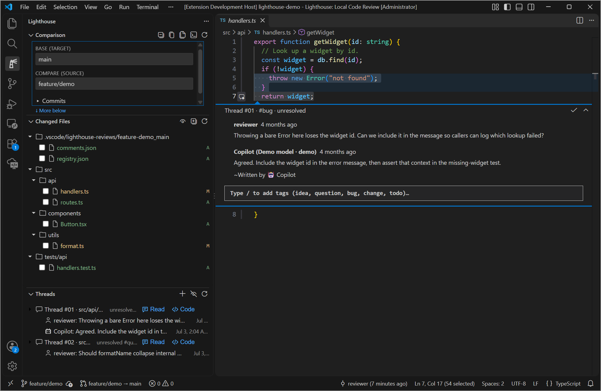

# Lighthouse: Local Code Review

A **local-only VS Code extension** for reviewing your own git branch diffs the way you'd review a
pull request — native inline comment threads, a three-view "PR panel", `/tag` classification, and a
one-click **Ask Copilot** round-trip, with every comment stored as plain JSON on disk.
Core review workflows work offline; optional Copilot and explicit Git network actions can use
the network.

> **Status:** local-only, single-developer tool. The extension **never calls a language model
> directly** — AI work stays in the external Copilot CLI. Reviews live under
> `.vscode/lighthouse-reviews/` (no review server or database), a superset of — and never a
> clobber of — the original `Gururagavendra.local-pr-review` format.

## Screenshot



_Current three-view layout with Commits embedded in Comparison, captured using only synthetic
widget-service code and review comments — see [`DEMO.md`](./DEMO.md)._

## What it does

- **Three-view review panel** in a dedicated Activity Bar container, all driven by one in-memory
  *active comparison* (`base` = target branch or commit, `compare` = source branch under review):
  - **Comparison** — inline `Base` / `Compare` selectors above a collapsed **Commits** section,
    loaded on first expansion and cached for reopening. **History** walks source ancestors;
    **Review** shows `git log base..compare`. Right-click any
    commit and choose **Set as Base** to pin its SHA, **Copy Commit SHA**, or **Open Commit Diff**.
    **↶ Unpin** beside Base returns to automatic branch/shared-ancestor selection.
  - **Changed Files** — a hierarchical folder tree of changes from the effective baseline to the
    source, with per-file reviewed checkboxes; click opens a native diff. The default cumulative
    mode includes saved working-tree and untracked changes when the source is checked out.
  - **Threads** — inline and review-wide discussions for the active review. Code-linked rows
    navigate to code; **Read** opens the complete discussion, and **New Thread** starts a
    review-wide discussion without a code location.
- **Native inline comment threads** — comments render as first-class VS Code `CommentController`
  threads in the editor gutter, with reply, resolve / unresolve, and copy commands.
- **`/tag` classification** — type `/` in any comment box for autocomplete over the tag set; tags
  are merged into the thread on submit.
- **Ask Copilot round-trip** — hand a review thread to the `copilot` CLI; when the agent writes its
  reply back into `comments.json`, a file watcher reloads and re-renders it in-thread. The extension
  only ever *shells out* — it never calls a model itself.
- **Optional MCP tools for your existing CLI session** — discover reviews, read a thread index
  with initial-comment previews, read complete discussions, and append agent replies. The local
  stdio server is bundled with Lighthouse; it never calls a model or submits prompts itself.
- **Plain-JSON storage** — reviews are human-readable JSON under `.vscode/lighthouse-reviews/`,
  created lazily on first mutation so clean repos stay clean. Durable thread ids and v1/v2
  back-compat are preserved on every write.

## Quick start

The extension is not on the Marketplace yet. Build and install into your local VS Code from
source. Local development is Windows-first and requires Node.js/npm compatible with the locked
tooling, PowerShell (`pwsh` for the commands below), and the **`code` CLI** on `PATH`.

```powershell
# From the repo root, set up dependencies once (or after dependency changes).
npm ci

# Build, package and install into local VS Code.
pwsh -File .\scripts\deploy-local.ps1
```

For later source edits, rerun only the deploy command, then use **Developer: Reload Window** in
VS Code. Each new source build prepares today's calendar version once and synchronizes the
manifest, lockfile and native header. Packaging rejects stale dates or split metadata.
To reinstall the existing VSIX without preparing another version or rebuilding:

```powershell
pwsh -File .\scripts\deploy-local.ps1 -InstallOnly
```

For debugging without installation, select **Run Extension** in VS Code and press F5. The
checked-in launch configuration compiles and opens an Extension Development Host.
See [engineering.md](./docs/engineering.md) for compile-only, package-only and test commands.

Core review requires a trusted, disk-backed workspace, VS Code and Git on `PATH`.
Lighthouse is disabled in Restricted Mode and virtual workspaces; only grant trust to code you
have reviewed and trust. Core review does not require Copilot or a separate
Node.js installation when using an already-built VSIX. Ask Copilot additionally requires an
installed, authenticated `copilot` CLI and the permissions needed for the requested actions.
The review-store location assumes a single workspace folder; other platforms and remote/virtual
workspaces are not established support claims.

## AI tools and review files

The tool-independent [comment-file schema](./docs/data-model.md) documents how to read
`.vscode/lighthouse-reviews/**/comments.json`, including v1/v2 compatibility, replies, authors
and durable thread IDs. Supply that documentation explicitly to another AI tool before asking
it to edit reviews.

The current VSIX does **not** bundle a complete AI instruction document or install instructions
into a reviewed repository. Ask Copilot sends a short schema hint and assumes additional schema
guidance is supplied separately. The repo's
[Copilot instructions](./.github/copilot-instructions.md) are for developing Lighthouse itself,
not an agent contract distributed to extension users.

## Optional Copilot CLI MCP integration

The server is named **`lighthouse-codereview`** to avoid collisions with unrelated Lighthouse
tools. The VSIX includes the standalone server and a headless setup helper. MCP use additionally
requires **Node.js 22+**, Git, and Copilot CLI on the same local filesystem; core review is unchanged.

The recommended local workflow builds/installs the extension, registers its user-level MCP entry,
and verifies the standalone payload without model calls:

```powershell
pwsh -File .\scripts\setup-mcp.ps1 -WhatIf   # optional no-change preview
pwsh -File .\scripts\setup-mcp.ps1           # confirm the setup operation
```

Use `-VsixPath` for a current prebuilt package, or `-UseInstalledExtension` after installation
from another source. The script does not reload a working editor or restart an agent: finish
with **Developer: Reload Window**, start a fresh CLI session in the reviewed worktree, and
inspect **`lighthouse-codereview`** in `/mcp`.

See **[Local MCP setup](./docs/mcp-setup.md)** for the automated path, complete manual fallback
checklist, custom paths/profiles, owned-legacy migration, limits, and troubleshooting.

| Tool | Result |
|---|---|
| `list_reviews` | Saved comparisons, identifiers, branches, counts, and explicit read/discovery issues |
| `get_review` | Thread index with location, state, tags, author, counts, and the first **64 Unicode characters of the initial comment** |
| `get_thread` | Complete comment bodies, author metadata, reply links, and a revision for subsequent writes |
| `reply_to_thread` | An agent reply appended to an existing thread, without changing its resolved state |

Read pages default to 50 items and allow up to 200; follow `nextCursor` to read more. Changed
data invalidates old cursors explicitly. Replies are limited to 64 KiB UTF-8; review files to
16 MiB and individual tool results to 1 MiB. Oversized content is an error, never silently
truncated. Legacy threads without persisted IDs are readable but not writable through MCP.

Copilot should read the thread, then submit its revision and a unique request ID with its reply.
Retrying the same request does not append a duplicate. Tool descriptions include this contract;
MCP users do not need to locate or manually edit the JSON schema. Replies coordinate with
updated Lighthouse writers, and the existing file watcher refreshes open discussions.

Registration is **once per user/CLI profile**, not per repository. Each stdio process uses its
CLI launch worktree; no HTTP listener, cloud service, automatic agent, or per-repository config
is needed. Normal CLI trust, tool permissions, disabled-server settings, and organization
policy still apply. Installation alone does not register or connect it.

The GUI command **Lighthouse: Configure Copilot CLI MCP** remains the manual setup/repair/removal
fallback, available in the top **Comparison** section's **…** menu and the Command Palette.
Only verified owned registrations using the old `lighthouse` name are migrated;
unrelated servers and intentional disablements are preserved.

Performance and feature-usage logging are local and enabled by default; there is no remote
telemetry upload. See [startup diagnostics](./docs/startup-diagnostics.md) and
[local feature usage](./docs/usage-diagnostics.md) for collected fields, export behavior and the
`lighthouse.perfLogging` / `lighthouse.usageLogging` settings.

## Tags

Classify a thread by typing `/` in the comment box and picking from the autocomplete:

`/idea` · `/question` · `/bug` · `/change` · `/todo`

(The full configurable set also includes `/nit` and `/praise`; edit `lighthouse.tags` to customize.)

## Documentation

Full knowledge base in [`docs/`](./docs/README.md):

- [architecture.md](./docs/architecture.md) — ownership split, the three views, the
  `CommentController`, and the Ask-Copilot bridge.
- [data-model.md](./docs/data-model.md) — on-disk layout, the v2 schema, v1 back-compat, the tag set,
  and the durable `seqCounter`.
- [engineering.md](./docs/engineering.md) — build / package / deploy commands, VM verification, and
  commit conventions.

See [`DEMO.md`](./DEMO.md) for the repeatable demo path and how to capture the screenshot above.

For troubleshooting, relevant diagnostics and the bug-report checklist, see
[`SUPPORT.md`](./SUPPORT.md).

## License

[MIT](./LICENSE)
